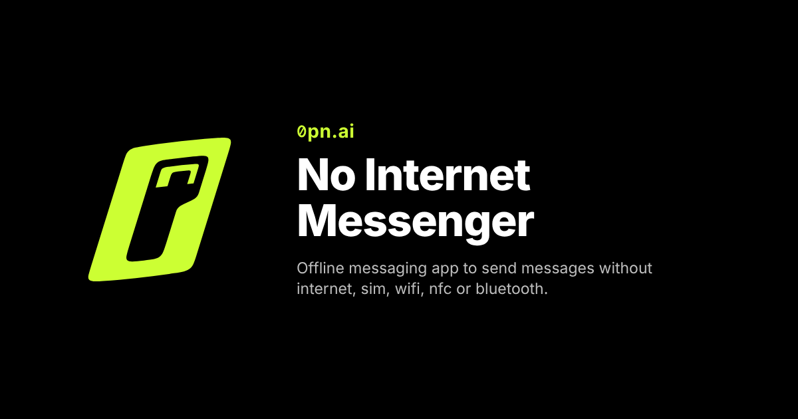

# No Internet Messenger (0pn.ai)

**Offline messaging app to send messages without internet, sim, wifi, nfc or bluetooth.**

Live app: **https://0pn.ai** — open it on two nearby devices and start messaging. Free, no sign-up, installable as an app on phones and computers.



## Features

- Works with no internet, SIM, Wi-Fi, NFC or Bluetooth
- One message reaches every nearby device at once
- No accounts, no servers, no tracking — nothing leaves your device
- Installable Progressive Web App (Android, iOS, Windows, macOS, Linux, ChromeOS)
- Single self-contained `index.html`, no build step, no dependencies

## Run it yourself

Serve the folder from any static web server **over HTTPS** (browsers only allow microphone access on secure origins; `http://localhost` also works for development):

```sh
npx serve .        # or: python3 -m http.server 8080
```

Then open the URL on two devices placed near each other.

## Project files

| File | Purpose |
|---|---|
| `index.html` | the whole app (markup, styles, script) |
| `manifest.json`, `sw.js`, `icons/` | PWA install and offline use |
| `web.config` | IIS settings (MIME types, caching, HTTPS redirect); ignore on other servers |
| `robots.txt`, `sitemap.xml`, `llms.txt`, `og-image.png`, `screenshot-mobile.png` | discovery and link previews |

## Contributing

Bug reports and pull requests are welcome (no response or fix is promised) — see [CONTRIBUTING.md](CONTRIBUTING.md). Please read the [Code of Conduct](CODE_OF_CONDUCT.md). Security issues: see [SECURITY.md](SECURITY.md).

## Buy me a coffee

If this is useful to you, you can [buy me a coffee](https://buymeacoffee.com/tirmizisamir). ☕ This is a personal project shared as is: there is no commitment to support, maintenance, updates or responses to issues.

## License and trademarks

The source code is licensed under the [Apache License 2.0](LICENSE) — use it, modify it, ship it, commercially or not; it comes with no warranty and the authors accept no liability (see sections 7 and 8 of the license).

The names **0pn**, **0pn.ai**, **No Internet Messenger**, the logo, icons and wordmark are trademarks of Samir Tirmizi and are **not** covered by the license. Forks and derived products must use their own name and branding. See [TRADEMARKS.md](TRADEMARKS.md).

Use of the hosted service at https://0pn.ai is governed by its [Terms of Use](https://0pn.ai/#terms) and [Privacy Notice](https://0pn.ai/#privacy).

Developed by [Samir Tirmizi](https://www.linkedin.com/in/tirmizisamir/), [BinaryThinkers.com](https://binarythinkers.com/).
